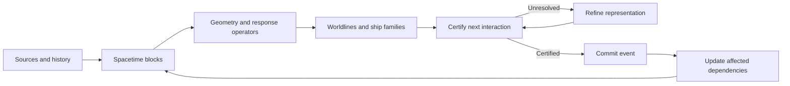

PLEASE IMPLEMENT THIS PLAN:
# Emergent Space: engine architecture and agent-led build plan

## 1. Objective and governing decisions

Build a **deterministic spacetime engine** that represents predictable evolution compactly, computes consequential interactions when required, and supports an interactive observatory on the **M1 MacBook Air with 8 GB RAM**.

The target is **one billion individually addressable ships and histories spanning ten billion simulated years**, under explicitly measured workloads. Population size, elapsed time, and independently changing state must be measured separately and together.

The orchestrator and sub-agents are the **development team**. They research, implement, test, and integrate the engine.

The finished deliverable includes:

- Planar motion with subluminal travel, proper time, causal gravity, collisions, navigation, and delayed observations.
- Procedural space, deterministic history, compressed populations, persistence, and replay.
- A zoomable observatory with player actions and separate scientific debugging views.
- Reproducible correctness, physical-behavior, and performance evidence.

The [conversation](</Users/julien_laurent/Downloads/Reconstruct emergent space idea.md>) supplies intent and constraints; the [research report](</Users/julien_laurent/Downloads/deep-research-report (4).md>) supplies architectural candidates. Neither establishes that the proposed gravity law or billion-scale compression already works.

**The build therefore has two foundational gates: prove a complete lazy causal loop, then establish the executable physical law that the optimized engine must preserve.** Failure at either gate remains visible and blocks dependent claims.

## 2. Unified architecture

### Canonical reality and derived representations

Authoritative reality consists of:

**Law version + seed + procedural generators + player interventions + irreducible event facts.**

World positions, decoded ships, spatial indexes, trajectory approximations, and caches are derived representations.

Use six shared concepts throughout the engine:

| Concept | Responsibility |
|---|---|
| Event | A canonical interaction or change with explicit causal predecessors |
| Generator | Compact, evaluable evolution over an interval |
| Response | A reusable mapping from a block’s admitted inputs to its outputs |
| Certificate | A sound bound establishing a result or an interval without relevant interaction |
| Dependency | The facts and assumptions on which a result depends |
| Population | Stable identities represented individually or through certified families |

The central execution path is:

### Numerical and physical contract

Use versioned dyadic units, coupled spatial and temporal quanta with \(c=1\), hierarchical coordinates, and block-local integers. Choose the finest canonical quantum jointly with the physical law.

Approximate arithmetic may propose results. A committed branch requires a sound certificate or the authoritative evaluator of the same law. Adaptive predicates provide a proven precedent for this pattern, although extending it to whole trajectories requires additional work. [Shewchuk’s primary reference](https://www.cs.cmu.edu/~quake/robust.html)

Required semantics:

- Widen operands **before subtraction and multiplication**; use arbitrary precision when fixed widths cannot safely represent the complete expression.
- Define rounding, contact, simultaneous interactions, conservation accounting, and proper-time accumulation as part of the law.
- Quantization occurs at law-defined boundaries. Splitting a trajectory for scheduling or caching must not introduce additional rounding.
- Every supported predicate has a terminating authoritative decision procedure. “Keep increasing precision” is insufficient for exact equality.
- Refinement may change computation, never physics. Unsupported queries return an explicit capability failure; exhausted execution budgets return resumable work.

Select representations by their certified validity and measured cost. Object names, camera distance, and arbitrary speed thresholds do not determine fidelity.

### Spacetime, gravity, and long-time propagation

Use a **spatial quadtree crossed with an independently refined dyadic time tree**. Store source histories, worldtube bounds, response operators, and dependencies on these blocks.

Compile source influence into reusable geometry. All mass participates, including ship populations; compression must retain both collective backreaction and cumulative small effects.

The physical kernel must explicitly reproduce the intended familiar gravitational behavior restricted to planar motion. A quadtree does not imply the logarithmic kernel of literal two-dimensional gravity.

Implement direct evaluation as the small-system reference and bounded FMM as the primary acceleration candidate. GADGET-4 supplies a useful momentum-conserving FMM exemplar, but its results do not establish a causal relativistic implementation here. [GADGET-4 paper](https://academic.oup.com/mnras/article/506/2/2871/6312509)

Long-time propagation must satisfy three obligations:

1. Jumping directly and evaluating through intermediate subdivisions produce the same canonical result.
2. The interval certificate covers possible interactions throughout the jump.
3. Perturbations that can accumulate into later consequences remain represented.

Analytic inertial, regularized orbital, stationary-metric, and controlled-flight propagators implement one interface. They become optimization paths only where their relationship to the chosen canonical law is established.

The procedural background requires a well-defined gravitational exterior response and certified unresolved-source bounds. Generation reveals predetermined matter. It cannot create gravity when a region is observed. An artificial cutoff or cosmological horizon is not an implicit optimization.

### Ship populations: indexed families plus exceptions

Make **parametric families** the primary large-population representation:

**Shared route or flow + departure/parameter sequence + stable identity range + sparse exceptions.**

This represents spatially distinct ships and allows random access to a particular member. Exact identical-state multiplicity is a narrower supported case.

Every family provides:

- Member decoding and deterministic partitioning.
- Enclosed geometry and source contributions.
- Earliest possible member interaction.
- Selective extraction of affected identities.

Identity-dependent messages, collisions, observations, and policy changes trigger refinement or extraction only where required. Distinct information is retained when compression fails.

Randomness is keyed by stable semantic identity, event, seed, and purpose. Packet identifiers and execution order cannot affect draws. Counter-based generators support this addressing pattern. [Random123](https://random123.com/)

### Responses, history, and persistence

Cache certified mathematical responses with explicit input domains and dependency versions. Start with empty-space transport, stationary geometry, and simple trajectory families.

Use min-plus for admissible arrival-time composition. Navigation responses include departure time and the boundary state needed for composition, such as velocity and available propulsion. A distance-only matrix cannot represent general spacecraft navigation.

A block’s interior may leave active memory only when its outgoing influence is sufficiently represented. Retain reconstruction provenance; do not assume a compact response exists for every nonlinear history.

Separate:

- Immutable facts and interventions.
- How much predetermined history has been evaluated.
- Uncommitted forecasts.
- Optional alternative-history branches.

Compare canonical digests over the **same branch and declared spacetime domain**. Cache contents and materialization order are excluded.

Persist versioned manifests, immutable event chunks, checkpoints, and rebuildable indexes. Checkpoints must be atomic and verified on recovery. A law-version mismatch requires explicit compatibility handling.

### Runtime, APIs, and observatory

Implement the core in Rust, with a headless library and native observatory. Use `wgpu` with its Metal backend for rendering and qualifying compute kernels. [Official wgpu documentation](https://wgpu.rs/)

Expose these capability boundaries:

| Interface | Result |
|---|---|
| `advance(branch, target, budget)` | Certified progress, completion, or resumable pending work |
| `query(request, budget)` | Certified answer with validity domain, or continuation |
| `intervene(observer, command)` | Validated causal action and stable event identity |
| `inspect(entity, event_or_time)` | Reconstructed state and provenance |
| `checkpoint`, `restore`, `verify` | Versioned persistence and integrity results |

Internally, propagators expose state, interval enclosure, earliest-event certification, and representation splitting. Responses expose application, composition, and domain validation.

Start with an indexed event heap and conservative causal execution. Process independent work concurrently; commit only before proven incoming-event bounds. Resolve same-time dependent interactions through the law’s simultaneous-event semantics. Include explicit zero-lookahead progress handling.

Make long operations cooperative and resumable from the start. The observatory remains responsive while unresolved simulation work continues.

The observatory provides navigation, time control, delayed sensor returns, occlusion, historical tracks, and uncertainty. A clearly separated diagnostic view exposes true geometry, certificates, dependencies, and resource use. Camera operations never alter canonical history.

## 3. Development orchestration

Use **one orchestrator and up to three concurrent specialists**, rotating assignments by milestone.

| Role | Ownership |
|---|---|
| Orchestrator/integrator | Contracts, dependency graph, priorities, integration, release evidence |
| Mechanics specialist | Executable laws, canonical evaluator, propagators, source bounds |
| Systems specialist | Scheduler, populations, storage, responses, observatory, acceleration |
| Independent verifier | Oracles, adversarial fixtures, differential testing, benchmark audit |

Each task packet contains its objective, prerequisites, owned modules, interface version, allowed approximations, acceptance commands, resource budget, evidence outputs, and rejection criteria.

Working rules:

- Isolate implementation branches/worktrees; shared-interface changes pass through the orchestrator.
- Freeze evaluation fixtures before tuning candidates.
- Require independent review of certificate bounds and authoritative numerical semantics.
- Integrate one optimization family at a time so regressions have an identifiable cause.
- Preserve failed experiments, counterexamples, and rejected designs.
- Run only one heavy build or performance experiment at a time on this machine.
- Separate research outcomes from implementation completion: a promising paper or passing scaffold is not a validated subsystem.

The repository will contain a machine-readable task graph, human-readable architecture decisions, and reproducible evidence manifests. A Rust task runner will provide standard commands for reference runs, parity checks, benchmarks, and release qualification.

## 4. Gated implementation sequence

| Gate | Work and parallel assignments | Required exit evidence |
|---|---|---|
| **G0 — Contracts and harness** | Orchestrator establishes interfaces and task graph; mechanics defines initial semantics; verifier builds independent fixtures; systems creates headless/observatory scaffolding. | Reproducible build, versioned scenario format, resource measurement, deterministic seed/identity vectors. |
| **G1 — Complete causal loop** | Implement inertial motion, signals, controlled impulses, contacts, simultaneous events, dependency updates, replay, and a minimal viewer. | Accelerated execution matches independent exhaustive small-world results, including missed-between-samples and exact-contact cases. |
| **G2 — Physical-law qualification** | Compare generator-friendly discrete variational mechanics and piecewise-metric formulations. Establish causal source coupling, proper time, collisions, compact-source behavior, exterior physics, and reference evaluation. | One executable law with documented domains, finite decision procedures, physical-behavior results, and valid long-time shortcuts. |
| **G3 — Certified physical engine** | Build worldtubes, event isolation, source histories, direct gravity, reusable propagators, and source-evolution events. Verifier attacks accumulated perturbations and transitions. | The complete physical interaction loop passes parity and conservation/accounting checks. |
| **G4 — Population and gravity scaling** | Implement indexed ship families and bounded FMM in parallel behind frozen interfaces. | Individual identity preservation, exact split behavior, contained source errors, aggregate backreaction, and measured cost reductions. |
| **G5 — Spacetime reuse and persistence** | Add response composition, dependency-local caching, block sealing, checkpoints, reconstruction, and historical queries. | Cached/direct parity, query-order invariance, correct invalidation, crash recovery, and positive measured amortization. |
| **G6 — Navigation and observatory** | Complete moving-target navigation, propulsion accounting, delayed sensing, occlusion, historical knowledge, time control, and diagnostics. | A controllable ship completes a causally correct journey through a changing system; observation never changes physics. |
| **G7 — Parallelism and acceleration** | Add conservative multiworker execution, workload balancing, and sufficiently large GPU batches. | Identical canonical results across schedules and backends; end-to-end improvement after verification and synchronization costs. |
| **G8 — Scale qualification** | Run population, age, interaction-density, intervention, and persistence sweeps; package the native application and evidence. | Published operating envelope and passing integrated billion-scale workload on the target machine. |

For G2, reject candidates that lack a computable canonical evaluator, sound causal behavior, bounded exterior treatment, or required physical regimes. Among passing candidates, select by fully charged runtime, then memory, then implementation complexity. Freeze the law and quantum only after the held-out suite passes.

If no candidate passes, the output is a verified causal kernel plus a specific research failure. Downstream scaffolding may continue, but gravity and billion-year physical-evolution claims remain unqualified.

Do not equate Newtonian gravity with an added propagation delay to a validated GR approximation. Do not assume higher PN order supplies a rigorous remainder bound. Regge and variational formulations are candidate law constructions, not automatic higher-accuracy solver modes.

## 5. Testing and release acceptance

### Independent correctness and physical-behavior tracks

**Implementation correctness:** all representations of the same law must agree on canonical results.

**Physical behavior:** compare different quanta and external references through invariants, drift, regimes, and distributions. Chaotic trajectories need not remain pointwise identical. REBOUND provides useful independent integrators and reference scenarios. [REBOUND documentation](https://rebound.hanno-rein.de/integrators/)

Required test families:

| Family | Scenarios |
|---|---|
| Arithmetic and geometry | Integer extrema, grazing contacts, repeated roots, simultaneous contacts, near-light-speed motion |
| Causality | Moving emitters/receivers, delayed gravity changes, same-boundary arrivals, zero lookahead, partition changes |
| Long-time behavior | Regular/eccentric orbits, resonances, scattering, proper-time accumulation, source evolution, tiny perturbations with late consequences |
| Representation invariance | Whole versus subdivided jumps; different refinement orders; camera/query order; cache eviction |
| Populations | Individual messages and collisions inside large families, arbitrary splitting, identity-specific randomness, deliberate fragmentation |
| Source compilation | Extreme mass ratios, clustering, cancellation, moving sources, aggregate ship backreaction |
| Responses and storage | Domain rejection, causal invalidation, historical reconstruction, interrupted checkpoints, corrupted chunks |
| Parallel/GPU parity | One/many workers, randomized task ordering, difficult numerical batches, CPU fallback |
| Overload | Event storms, growing dependency graphs, exhausted memory/disk budgets, cancellation and resumption |

Use exact analytic geometry or sound root isolation for collision oracles. Dense temporal sampling alone cannot establish absence of an intersection.

Every optimization needs both a correctness argument for its supported domain and differential evidence. Any incorrect certified commit blocks release.

### Scale workloads

Freeze workload definitions and seeds before optimization. Include:

1. **Population sweep:** \(10^3\) through \(10^9\) distinct addressable ships, plus a \(10^{10}\) stretch case.
2. **Age sweep:** increasing horizons through \(10^{10}\) years, measuring retained history and unresolved work.
3. **Integrated case:** \(10^9\) ships across many spatially distinct families, gravitational sources, source evolution, addressed interventions, sensor queries, and actual interactions over a \(10^{10}\)-year horizon.
4. **Compression-destroying controls:** individualized trajectories, dense encounters, repeated messages, and broad causal invalidations.

A free-flight shortcut or multiplicity-only demonstration passes its mechanism test; it does not satisfy integrated scale qualification.

Report logical ships, distinct generators, extracted ships, active sources, certificates, committed events, cache construction, dependency bytes, archival bytes, and cold reconstruction cost. Include startup and initialization in cold measurements.

### Proposed M1 acceptance budgets

These are engineering targets to validate, not measured capabilities:

- **Memory:** at most 4 GiB total runtime footprint, including GPU allocations counted once.
- **Observatory:** at least 30 FPS at 1080p in the qualified interactive workload; long queries return pending work without blocking input.
- **Integrated scale run:** complete the frozen billion-ship/ten-billion-year scenario within one hour from cold start, including final checkpoint and integrity verification.
- **Benchmark storage:** at most 20 GiB for the qualified run, with retained history and rebuildable caches reported separately.
- **Acceleration:** enable a GPU path only when matched full-pipeline measurements show a benefit. The revised SWIFT heterogeneous study illustrates how preparation and post-processing can dominate offload cost. [SWIFT study](https://arxiv.org/abs/2505.14538)

On overload, slow simulated progress, evict reconstructible caches, and checkpoint or pause cleanly. Preserve canonical events and physical semantics.

Release evidence must include exact commands, source revision, law version, seeds, hardware, cold/warm results, parity digests, failures, and the measured limit for independently active ships. The engine is complete against this plan only when the integrated gates pass; extreme headcount or elapsed-time labels alone are insufficient.

