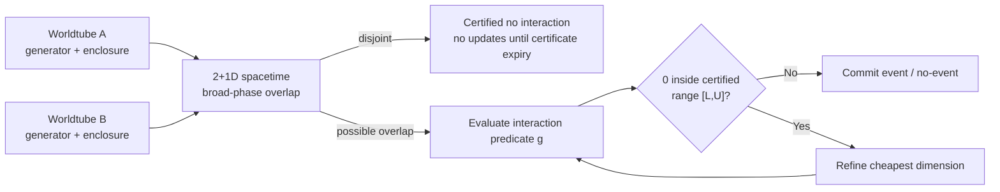
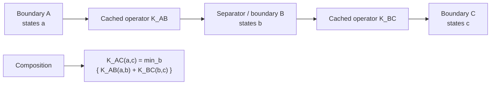
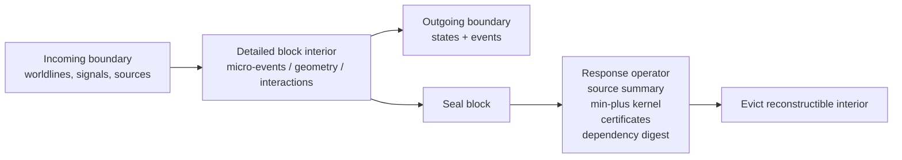
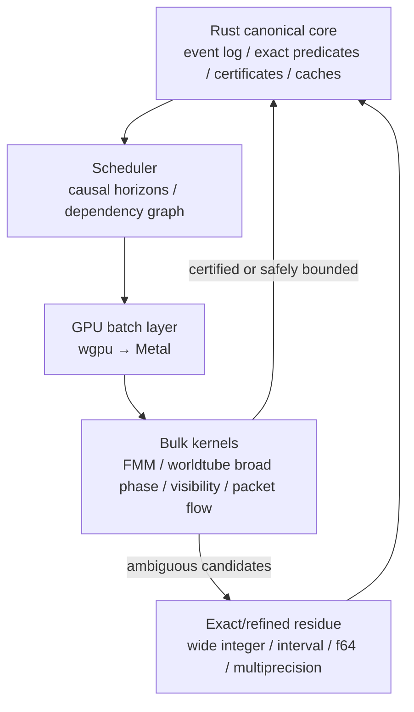
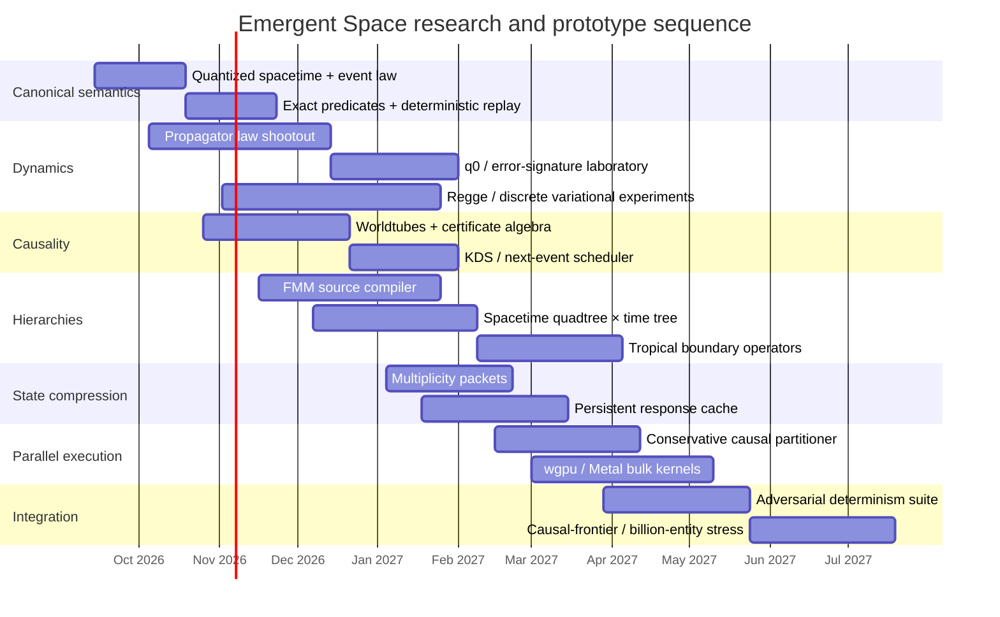
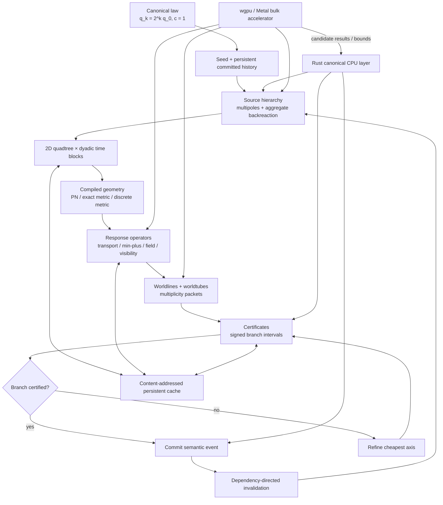

# Emergent Space: A Unified Architecture for Quantized Causal Mechanics

## Executive summary

The strongest architecture that emerges from the literature is not a conventional game engine with extreme optimization, nor an astrophysical \(N\)-body simulator with variable timesteps. It is better understood as a **deterministic spacetime compiler**:

> **Emergent Space should define an exact, quantized game universe; compile its slowly changing causes into reusable spacetime geometry and response operators; represent motion as worldlines rather than updates; and spend computation only where a consequential branch cannot yet be certified.**

This synthesis combines ideas that already work independently in robust computational geometry, celestial mechanics, fast multipole methods, discrete variational mechanics, hybrid-system reachability, kinetic data structures, discrete-event simulation, tropical dynamic programming, incremental computation, and large-scale astrophysical codes. Shewchuk's adaptive predicates demonstrate that most geometric decisions can be evaluated cheaply and only ambiguous signs require extra precision; KDSs maintain moving systems through certificates that fail at discrete moments; JANUS shows that integer phase-space coordinates can support exact reversible discrete dynamics; variational integrators derive discrete mechanics from an action rather than discretizing differential equations after the fact; GADGET-4 and SWIFT demonstrate hierarchical gravity and workload-oriented extreme-scale execution; and tropical/Hamilton–Jacobi mathematics provides a genuine algebra for arrival and transfer problems rather than merely an analogy. citeturn22search0turn22search1turn19academia0turn22academia30turn20academia2turn30academia33turn23search2

The resulting canonical architecture is:

\[
\boxed{
\begin{array}{c}
\text{seed + immutable game laws + committed events/deltas}\\
\downarrow\\
\text{quantized source history in }(X,Y,T)\\
\downarrow\\
\text{compiled spacetime geometry / field summaries}\\
\downarrow\\
\text{cached propagators and boundary-response operators}\\
\downarrow\\
\text{worldlines/worldtubes and multiplicity packets}\\
\downarrow\\
\text{certificates for the next consequential predicates}\\
\downarrow\\
\text{event if certified; refinement if ambiguous}\\
\downarrow\\
\text{commit branch, invalidate causal descendants, recompress}
\end{array}}
\]

The **canonical spacetime** should be dyadic. Choose one fundamental spacetime quantum \(q_0\), set \(c=1\), and admit coarser working resolutions

\[
q_k = 2^k q_0.
\]

Canonical events have integer coordinates

\[
E=(T,X,Y)\in\mathbb Z^3.
\]

The background maximum-causality predicate can therefore be evaluated exactly, without square roots:

\[
\Delta T\ge0,\qquad
\Delta T^2\ge \Delta X^2+\Delta Y^2.
\]

That predicate should be interpreted as the **exact broad causal envelope of the game law**, not as the complete answer inside curved geometry. Fine arrival through gravity is delegated to a certified metric/propagator query. This preserves the computational gift of exact integer causality while allowing gravitational delays, lensing and curved paths. Causal-set research is useful as a conceptual precedent for treating causal partial order and discreteness as primary, although Emergent Space's deliberately dyadic lattice has a preferred frame and therefore should not be confused with Lorentz-invariant causal-set constructions. citeturn28academia1

The central runtime invariant should be:

> **Approximate state; certify branches.**

If a consequential predicate is \(g(s)>0\), an approximate model does not need to know \(s\) exactly. It needs a certified enclosure

\[
g(s)\in[L,U].
\]

Then:

\[
L>0 \Rightarrow \text{branch true},
\]

\[
U<0 \Rightarrow \text{branch false},
\]

\[
0\in[L,U]\Rightarrow\text{refine}.
\]

If exact refinement proves \(g=0\), zero is not a numerical failure: it invokes an explicit simultaneous/tie rule. This is the generalization of Shewchuk's adaptive exact-predicate strategy from computational geometry to an entire simulation architecture. citeturn22search0

Crucially, there is **not one refinement knob**. Ambiguity can be removed by revealing more dyadic bits, opening more FMM source nodes, increasing multipole order, subdividing a spacetime block, changing the physics representation, tightening a flowpipe, splitting an aggregated fleet, or finally using exact/wide arithmetic. The engine should choose the cheapest refinement expected to move the predicate interval away from zero.

The requested Newtonian \(\rightarrow\) PN \(\rightarrow\) exact-metric \(\rightarrow\) Regge hierarchy needs one correction. The first three can sometimes form an approximation sequence: post-Newtonian theory is explicitly a systematic relativistic expansion, while stationary black-hole geometries admit analytic equatorial geodesics. But Regge calculus and discrete variational mechanics are not “more accurate modes after exact GR”; they are **alternative representations from which the canonical discrete game law might be constructed**. Regge calculus puts curvature into a simplicial geometry, while variational integrators derive discrete evolution from a discrete action and can preserve geometric structure by construction. citeturn30academia34turn28academia4turn23search3turn22academia30

That distinction suggests a promising research competition rather than premature commitment:

| Candidate role | Best use in Emergent Space | Fundamental caution |
|---|---|---|
| Analytic inertial/Kepler/regularized flow | Vast majority of predictable motion | Must detect when perturbations invalidate generator |
| Newtonian/low-PN expansion | Weak-field source-to-geometry compilation | Never allow an instantaneous global force update to violate causal architecture |
| Higher PN | Relativistic corrections while expansion certifies itself | Series ceases to be useful in strong-field regimes |
| Exact Schwarzschild/Kerr-like metric | Stationary compact-object patches | Does not solve arbitrary interacting compact-body GR |
| Regge-inspired piecewise-flat metric | Candidate native discrete geometry | Mesh/lattice artifacts can become game physics |
| Discrete/async variational law | Candidate native mechanics | Structure preservation does not automatically imply desired game behavior |
| IAS15/direct high precision | Reference oracle and rare unresolved interaction | Too expensive as universal representation |

IAS15 is especially useful as an oracle because Rein and Spiegel engineered its implementation so systematic error falls below floating-point noise and long-term energy errors approach Brouwer's random-walk law; JANUS is useful for the orthogonal lesson that a discrete integer state map can be exactly reversible relative to its own laws. Neither should simply become the game engine. citeturn21view2turn19academia0

The gravity architecture should similarly be **compile and reuse**, not “calculate forces for every ship.” Massive source histories are summarized hierarchically, preferably with an FMM-like source/sink formulation. The result becomes a reusable geometry/field representation through which negligible-backreaction ships travel. GADGET-4 provides a momentum-conserving FMM implementation as an alternative to TreePM; SWIFT uses FMM gravity and task-based, workload-balanced parallelism and has demonstrated representative simulations of roughly \(300\) billion particles. citeturn20academia2turn30academia33

This also resolves the planet \(\rightarrow\) ship but usually not ship \(\rightarrow\) planet asymmetry without hardcoding categories. Every ship mass can enter aggregate source summaries. One ship's individual effect may remain below every relevant branch margin and never be opened. A fleet of \(10^{10}\) ships can have a collective monopole/multipole large enough that the hierarchy's aggregate becomes consequential. **Backreaction emerges automatically from aggregated influence rather than an object-type switch.**

The best spatial hierarchy is not a conventional 3D octree. The universe has two spatial coordinates, so use a **spatial quadtree crossed with a dyadic time tree**. A spacetime block is therefore:

\[
B = Q_{xy}\times I_t.
\]

It may be split only in space, only in time, or in all axes as needed. Its cached mathematical contents can include source multipoles, metric parameters, worldtube envelopes, min-plus transfer kernels, outgoing events, dependencies and certificates. Time-domain FMM research is particularly relevant because it explicitly combines multipole/local coefficients with a **space-time hierarchy** for retarded interactions rather than treating time as an external loop. citeturn24academia25

For causal movement and information, min-plus should be pushed hard—but only where the algebra genuinely fits. If \(K_{AB}(a,b)\) is the minimum travel time/action/cost from boundary state \(a\) to boundary state \(b\), adjacent regions compose as

\[
K_{AC}(a,c)
=
\min_b
\left[K_{AB}(a,b)+K_{BC}(b,c)\right].
\]

That is min-plus operator multiplication. Max-plus naturally expresses “when have all prerequisites arrived?” Boolean algebra expresses reachability. Ordinary addition/multiplication still expresses fields and multipoles. Lax–Oleinik/Hamilton–Jacobi evolution genuinely possesses tropical/min-plus structure in appropriate variational problems, so this is substantially more than a metaphor. citeturn23search2turn23search15

The scheduler should resemble a deterministic KDS/Next-Reaction machine. KDSs maintain certificates about a moving configuration and process only their predicted failures; Gibson–Bruck's Next Reaction method introduced a dependency graph plus indexed priority queue so one reaction updates only affected future reactions. Gillespie's original stochastic semantics are not appropriate for canonical deterministic reality, but its **jump-to-next-event** architecture is. Tau-leaping contributes a second idea: many events can be collapsed into one leap when that leap is known not to alter the relevant result. Emergent Space's version should be certificate-exact, not statistically approximate. citeturn22search1turn26search2turn25academia5

Caching then becomes part of the mathematical state *representation*, although not canonical truth. A sealed spacetime block should be eliminable into a boundary-response operator. The block's microscopic interior can leave hot memory once every possible future influence from that interior is represented on its outgoing boundary. The cache entry is immutable, content-addressed and dependency-aware, so a player action invalidates only cached results whose dependency sets lie in the action's causal descendants. Self-adjusting computation demonstrates the general feasibility of tracking control/data dependencies and propagating updates rather than recomputing from scratch. citeturn30academia35

Aggregation should also be exact wherever possible. Instead of a dichotomy between “particle” and “distribution,” represent an empirical measure

\[
\mu=\sum_j n_j\,\delta_{s_j}.
\]

An individual ship is \(n_j=1\). A million exchangeable ships in exactly the same relevant canonical state are one record with \(n_j=10^6\). The packet splits only when a future predicate can distinguish its members. This is much stronger than approximate particle LOD: it is quotienting the game state by an equivalence relation.

Finally, the growing-light-cone problem has no magical solution. In two spatial dimensions, a causal past of duration \(T\) has spacetime volume

\[
V(T)=\int_0^T\pi\tau^2\,d\tau=\frac{\pi T^3}{3}.
\]

If an infinite universe creates independent, forever-branch-relevant information at positive spacetime density, no finite computer can preserve all of it exactly forever. The architecture must therefore make cost track the **irreducible causal frontier and boundary response**, not raw causal volume. Old spacetime is progressively eliminated into boundary summaries; identical states merge; deterministic generators replace repeated motion; and only irreducible historical differences remain. An accelerating cosmology with an event horizon is an optional world-design mechanism for creating a genuinely finite asymptotic causal patch, but it should only be adopted if it belongs in the fiction and physics, not as an invisible optimization patch.

The deepest architectural decision is therefore not Rust, Metal, FMM, Regge or tropical algebra individually. It is this:

> **The unit of work is neither an entity nor a timestep. It is an unresolved consequential distinction in spacetime.**

Everything else should serve that invariant.

## The canonical model and correctness contract

**Technical summary.** The canonical universe should be defined independently of whatever arithmetic happens to be fast on current hardware. It is a sparse, deterministic, dyadically quantized causal mechanics. FP32, FP64 and GPU kernels can evaluate candidate answers, but they do not decide canonical reality unless their results are certified. JANUS is the closest astrophysical precedent for embracing discreteness deliberately: it combines integer and floating-point arithmetic to define a bit-wise time-reversible \(N\)-body map, and its discrete phase-space map is formally symplectic and exactly satisfies Liouville's theorem in the sense discussed by Rein and Tamayo. citeturn19academia0

Define the spacetime resolution hierarchy as

\[
q_k=2^k q_0,\qquad k\ge0,
\]

with \(q_0\) the finest **canonical spacetime** quantum. Working calculations normally use much coarser \(q_k\); refinement reveals lower-order bits rather than converting between unrelated discretizations.

Set \(c=1\) by coupling the base temporal and spatial units:

\[
q_t = \frac{q_x}{c}.
\]

An event is therefore:

```rust
/// Canonical spacetime coordinate.
/// Actual multiplication for causal predicates must widen beyond i128.
#[derive(Clone, Copy, Eq, PartialEq, Hash)]
pub struct EventPoint {
    pub t: i128,
    pub x: i128,
    pub y: i128,
}

#[derive(Clone, Copy, Eq, PartialEq, Hash)]
pub struct DyadicLevel(pub u8); // effective q_k = 2^k q_0
```

The exact broad causal predicate is:

```rust
pub fn inside_background_future_cone(a: EventPoint, b: EventPoint) -> bool {
    let dt = wide(b.t - a.t);
    if dt < 0 {
        return false;
    }

    let dx = wide(b.x - a.x);
    let dy = wide(b.y - a.y);

    dt * dt >= dx * dx + dy * dy
}
```

`wide()` here means a product width large enough that squaring cannot overflow. A coordinate stored in signed 128 bits does **not** imply 128-bit multiplication is sufficient. Shewchuk's work is a useful cautionary analogue: geometrical algorithms fail catastrophically when the sign of a determinant is wrong, and adaptive exact arithmetic is valuable because it increases precision only when the sign cannot otherwise be guaranteed. citeturn22search0

An illustrative scale check shows why fixed dyadic coordinates are not automatically incompatible with astronomical ranges:

| Candidate spatial \(q_0\) | Coupled time quantum \(q_t\) | Approx. signed bits for \(10^{10}\) light-years |
|---:|---:|---:|
| \(1\) m | \(3.34\) ns | \(88\) |
| \(1\) cm | \(33.4\) ps | \(94\) |
| \(1\) mm | \(3.34\) ps | \(98\) |

These numbers are **not recommendations for \(q_0\)**. They simply show that even a millimeter spacetime lattice can fit a ten-billion-light-year coordinate range comfortably in 128-bit signed coordinates. The square in a causal predicate can require roughly twice the magnitude width, so the engine should have a fast fixed-width wide-integer path and a rare arbitrary-precision fallback.

For a genuinely procedurally unbounded coordinate system, a single fixed integer cannot literally encode infinity. The clean solution is a hierarchical address plus block-local integer coordinates:

```rust
pub struct SpatialAddress {
    pub level: i32,
    pub morton_prefix: BigUnsigned, // cold/canonical address
}

pub struct LocalPoint {
    pub dx: i128,
    pub dy: i128,
}
```

Most simulation operations should compare nearby or same-block local coordinates and therefore stay in native widths. Arbitrarily distant addresses can remain sparse variable-length identifiers.

**Worldlines, not entity states.** Canonical moving state should normally be a generator over a spacetime interval:

```rust
pub struct WorldlineSegment {
    pub id: SegmentId,
    pub domain: TickInterval,
    pub generator: GeneratorRef,
    pub tube: TubeEnvelope,
    pub dependency_digest: Digest,
    pub certificates: SmallVec<[CertificateId; 4]>,
}
```

The generator might be inertial, regularized Kepler, a PN propagator, an exact stationary-metric propagator, a piecewise-flat path, a controlled spacecraft arc or a packet flow. REBOUND's modularity and its coexistence of specialized symplectic schemes, tree gravity and collision machinery is a useful exemplar of keeping representations modular rather than forcing all dynamics through one solver. citeturn19academia1

A worldtube is the spatial/temporal enclosure within which the canonical worldline is proven to lie at a chosen working resolution. Flowpipe methods in hybrid-system verification are a closely related concept: they compute guaranteed reachable enclosures and use them to test whether continuous trajectories can hit discrete guards. citeturn22search11turn22academia32



The key correctness object is therefore the **certificate**, not a timestep:

```rust
pub enum CertVerdict {
    ProvenTrue,
    ProvenFalse,
    ExactBoundary, // exact g == 0; semantic tie/simultaneity law applies
    Refine(RefinementHint),
}

pub struct Certificate {
    pub predicate: PredicateId,
    pub signed_range: CertifiedInterval,
    pub valid_domain: SpacetimeDomain,
    pub dependencies: DependencyDigest,
    pub working_level: DyadicLevel,
    pub expires_at: i128,
    pub proof_kind: ProofKind,
}
```

For the branch function \(g\),

\[
g\in[L,U].
\]

The certificate is resolved whenever \(0\notin[L,U]\). That collapses what could otherwise become a sprawling taxonomy of “position error,” “force error,” “phase error” and “timing error.” Internal approximations may calculate such bounds, but runtime correctness ultimately asks one common question:

\[
\boxed{\text{Can the current uncertainty cross a consequential branch surface?}}
\]

The **branch margin** is the certified separation from that surface. For a sign-definite interval,

\[
m=
\begin{cases}
L,&L>0\\
-U,&U<0.
\end{cases}
\]

Large \(m\) means the system may be represented brutally coarsely. Small \(m\) means computation is worth spending.

The refinement mechanism should itself be generic:

```rust
pub enum RefinementAxis {
    MoreDyadicBits,
    IncreaseMultipoleOrder,
    OpenSourceNode,
    SubdivideSpace,
    SubdivideTime,
    RaisePhysicsOrder,
    ChangePhysicsRepresentation,
    TightenWorldtube,
    SplitMultiplicityPacket,
    ExactArithmetic,
}
```

A deterministic cost model chooses the refinement expected to reduce interval width per unit compute:

\[
r^\*=\arg\max_r
\frac{\widehat{\Delta\,\text{certificate width}}(r)}
     {\widehat{\text{cost}}(r)}.
\]

This is an optimization heuristic; **its choice cannot affect canonical truth**. Different legal refinement sequences must converge to the same final branch.

That leads to a central determinism rule: **quantize at semantic boundaries, not arbitrary arithmetic boundaries.** If three gravitational contributions are to be applied in the same canonical event, do not round after each addition in CPU-thread order. Accumulate in a specified wide representation, then perform one canonical quantization. Otherwise

\[
Q(Q(a+b)+c)
\]

and

\[
Q(a+Q(b+c))
\]

can differ, making the scheduler part of the physics.

Likewise, spacelike-independent committed events must commute. Causal-set theory treats causal order as a partial order rather than a universal physical sequence, and that is the useful abstraction here even though the game's lattice is different. citeturn28academia1

The canonical ordering rule can be:

\[
(\text{causal predecessors})
\prec
(\text{event}),
\]

while unrelated events may execute in any runtime order. If two operations genuinely compete for the same canonical state at the same tick, they are **not independent**; create a batch/simultaneous event and define its game-law resolution explicitly.

Counter-based randomness is almost perfectly matched to this model. Random123 is explicitly built around counter-based generators, so random values can be derived directly from keys/counters rather than consumed from a mutable sequential stream. citeturn27search2

Use something conceptually like

\[
R =
H(
\text{world seed},
\text{semantic event ID},
\text{agent/packet ID},
\text{purpose},
\text{lane}
).
\]

Scheduling, thread count and packet materialization order then cannot change the nominal random draw.

**Residuals require one subtle correction.** If the game has a finite canonical quantum, “subquantum effect” cannot mean a hidden continuum value that secretly exists outside the game law. Instead, the game can define **canonical dyadic residual accumulators** in conjugate quantities. A force contribution too small to emit one momentum quantum is accumulated rather than thrown away:

\[
r_{n+1}=r_n+\Delta p_n,
\]

and whenever \(r\) crosses a quantization boundary, a canonical momentum quantum is emitted while the remainder stays in \(r\).

```rust
pub struct QuantizedImpulse {
    pub whole_quanta: i128,
    pub residual_numerator: i128,
    pub residual_shift: u8, // denominator = 2^shift
}
```

This is the deterministic analogue of error-feedback quantization: it prevents a long sequence of same-sign tiny influences from being silently rounded to zero. It also explains the asteroid-probe case: no step-by-step micro-update is needed; the accumulated future consequence can be calculated analytically and the next quantum-crossing event scheduled directly.

**Primary risk.** A regular dyadic lattice has preferred coordinate axes and a preferred background frame. Causal-set research goes to considerable lengths to reconcile fundamental discreteness with continuum Lorentz invariance; Emergent Space is deliberately making a different trade-off. citeturn28academia1 The mitigation is to avoid neighbor-cell motion rules. Worldlines connect arbitrary integer events, geometric distances use the isotropic quadratic predicate, and the validation suite explicitly measures angular lattice locking and resonance artifacts.

## Physics as compiled spacetime geometry

**Technical summary.** The highest-leverage physical decomposition is:

\[
\boxed{
\text{source history}
\rightarrow
\text{effective spacetime geometry}
\rightarrow
\text{propagator}
\rightarrow
\text{worldline/event}
}
\]

rather than:

\[
\text{all bodies}
\rightarrow
\text{all pairwise forces}
\rightarrow
\text{all positions next timestep}.
\]

This is especially powerful because influence is directed in magnitude. A star changes a spacecraft trajectory; one spacecraft ordinarily makes an immeasurably smaller contribution to the star. In celestial mechanics that limiting case is the familiar test-particle idea, and planar regularization work explicitly considers a massless particle that is affected by primaries without affecting their motion. citeturn30search3

The game should nevertheless avoid declaring “ships do not gravitate.” Every source contributes into a hierarchical source representation. Whether it needs to be opened individually is determined by its **aggregate effect bound relative to relevant branch margins**. Ten billion ships can therefore produce a collective monopole/multipole that matters even though no ship was ever evaluated separately.

A source node should expose:

```rust
pub struct SourceSummary {
    pub mass: QuantizedMass,
    pub com: QuantizedPoint,
    pub moments: MultipoleCoefficients,
    pub source_interval: TickInterval,
    pub max_effect_bound: EffectBound,
    pub earliest_internal_change: i128,
    pub dependency_digest: Digest,
}
```

For linear long-range kernels this is literally the territory of FMM. GADGET-4 includes a manifestly momentum-conserving FMM as an alternative to its earlier TreePM approach, while SWIFT's gravity solver uses FMM and combines it with task-based shared/distributed-memory parallelism and workload-based domain decomposition. citeturn20academia2turn30academia33

### Gravity alternatives

| Method | Scaling/structure | Best role here | Main failure mode |
|---|---|---|---|
| Direct source sum | \(O(N^2)\) for all-pairs | Small-\(N\) truth oracle and adversarial tests | Impossible at target scale |
| Barnes–Hut/tree | Hierarchical one-sided approximation | Useful prototype and diagnostic | Error/momentum behavior less naturally symmetric than FMM |
| FMM | Hierarchical source-to-sink expansions, near-linear at fixed accuracy in favorable settings | **Primary gravity-source compiler candidate** | Complex error certification and dynamic/adaptive implementation |
| Particle mesh / TreePM | Mesh long range + local correction | Dense/periodic cosmological regimes | Poor conceptual fit to sparse unbounded game world unless cosmology demands it |
| Time-domain/retarded FMM | Space-time source hierarchy | Research path for causal field changes | Substantially more complex than static FMM |
| Cached effective metric | Amortized field/geometry reused by arbitrarily many test trajectories | **Primary ship-facing representation** | Rebuild/invalidation if sources change frequently |

GADGET-4's FMM and SWIFT establish that hierarchical gravity is practical at extreme \(N\); time-domain FMM research is the particularly relevant extension for Emergent Space because it factorizes kernels in both space and time and builds multipole/local coefficients on a space-time hierarchy. citeturn20academia2turn30academia33turn24academia25

The important architectural distinction is that an FMM is not the ship integrator. It compiles source influence into a reusable representation. A billion low-mass ships can query one already-compiled field.

**Do not let “Newtonian approximation” reintroduce instantaneous action at a distance.** The canonical causal architecture should say that *changes* in source history can affect only their future causal domain. A weak-field Newtonian expression can still serve as the leading-order local value of an already-established gravitational geometry; it just cannot be implemented as “Jupiter moves, therefore every cell in the infinite universe instantly receives a new force.”

That is where the spacetime hierarchy matters:

```rust
pub struct SpacetimeBlockId {
    pub spatial_cell: SpatialCellId, // 2D quadtree
    pub time_slab: DyadicTimeSlab,
}

pub struct SpacetimeBlock {
    pub source_summary: SourceSummary,
    pub geometry: GeometryRef,
    pub transport: ResponseRef,
    pub certificates: CertificateSet,
    pub dependencies: DependencyDigest,
}
```

The structure is best thought of as

\[
\text{quadtree}_{xy}\times\text{dyadic-tree}_{t},
\]

not as a static quadtree and not as a generic 3D octree. Space and time may refine anisotropically. A slowly changing binary system might demand detailed spatial geometry but a long time slab; a supernova-like source event may demand a thin time slab without spatial refinement far from the source.

### The requested physics ladder is actually a representation lattice

Post-Newtonian theory supplies a systematic approximation scheme for relativistic gravity and has been pushed to high PN orders for compact-binary dynamics. citeturn30academia34 For an engine, the conceptual rule should be:

\[
F \sim F_0 + F_1 + F_2+\cdots,
\]

evaluate terms until a bound on the neglected remainder is too small to cross the current branch surface.

That makes “Newtonian” simply the case where \(F_0\) certifies the query. There should be no arbitrary global threshold such as “switch at \(0.1c\).”

Yet there are regions where the expansion is a poor representation. Equatorial Kerr timelike geodesics admit explicit analytical solutions, illustrating that a superficially “more relativistic” region may actually become **cheaper** when represented in the right coordinates rather than by stepping a generic ODE. citeturn28academia4

And two-dimensional motion gives us another gift: Levi-Civita regularization is specifically a planar Kepler transformation used to regularize binary collisions; the planar Kepler singularity is transformed into a far better-conditioned representation. citeturn30search3turn30search16 This is exactly the design principle Emergent Space should pursue:

> **Do not optimize an expensive equation until you have tried to choose coordinates in which the equation stops being expensive.**

Regge calculus pushes that idea onto spacetime itself. In Regge's simplicial formulation, spacetime geometry is represented by simplices and curvature is encoded through the way they fit, with Delaunay/Voronoi dual structures playing a natural role in formulations of the action. citeturn23search3

For Emergent Space, I would research a **Regge-inspired game metric**, not literal 2+1-dimensional Einstein gravity. Literal general relativity in reduced dimensionality is not simply ordinary 3+1 GR with one coordinate deleted. The game instead wants planar kinematics that reproduce the desired 3+1-derived behaviors. A piecewise-simple spacetime may let free propagation inside each patch be analytic, pushing almost all work to patch crossings.

Variational discretization is even more fundamental. Discrete variational methods derive update laws from a discrete action; spacetime variational electromagnetics has been generalized to unstructured spacetime meshes without a preferred numerical time coordinate and supports asynchronous evolution while preserving discrete geometric structure. citeturn22academia30 This directly supports the user's intuition that “different timesteps” may be an artifact of thinking in separate space and time rather than worldlines through spacetime.

The research question should therefore be:

> Can the canonical law be expressed as a discrete action on dyadic/simplicial spacetime such that free or near-free geodesic propagation is closed-form or boundary-only, while the resulting long-time game dynamics pass the desired regime tests?

That is more promising than beginning with continuous GR equations and making every evaluation faster.

### Propagator API

A common abstraction can hide the underlying representation:

```rust
pub trait Propagator {
    /// Candidate/enclosed state at canonical tick t.
    fn state_at(
        &self,
        t: i128,
        level: DyadicLevel,
    ) -> CertifiedState;

    /// Enclosure over an interval, for collision/visibility/interaction queries.
    fn worldtube(
        &self,
        interval: TickInterval,
        level: DyadicLevel,
    ) -> TubeEnvelope;

    /// Attempt to certify a consequential predicate without materializing
    /// intermediate trajectory states.
    fn certify(
        &self,
        predicate: &Predicate,
        ctx: &QueryContext,
    ) -> Certificate;

    fn split_at(&self, t: i128) -> (PropagatorRef, PropagatorRef);
}
```

Candidate implementations:

```rust
pub enum FlowModel {
    Inertial(InertialMap),
    KeplerRegularized(KeplerMap),
    PostNewtonian { order: u8, coeffs: PNRef },
    StationaryMetric { metric: MetricRef },
    PiecewiseMetric { mesh: GeometryRef },
    ControlledTrajectory { plan: FlightPlanRef },
    PacketFlow { packet: PacketId },
}
```

The engine is not deciding which *object class* deserves which solver. Each representation attempts to certify its own validity. An inertial generator may remain valid for a relativistic ship in nearly empty space; a slow body near a compact source may immediately reject it.

### Comparison of integrator/propagator exemplars

| Exemplar | What to steal | What not to infer |
|---|---|---|
| REBOUND / Wisdom–Holman style splitting | Exploit a dominant integrable structure instead of integrating it numerically | A central-body split is not universal |
| IAS15 | High-accuracy reference oracle; explicit control of bias and roundoff | High order everywhere is not a scalable game architecture |
| JANUS | Exact discrete map, integer canonical state, exact reversibility | Reversibility alone does not guarantee the desired game dynamics |
| TRACE / hybrid encounter schemes | Change representation when structural assumptions fail | Avoid a zoo of ad-hoc object-specific modes |
| AVI / discrete variational methods | Build structure preservation into the discrete law | Conservation is not the same as behavioral fidelity |
| Regge calculus | Make geometry itself discrete/piecewise simple | Literal 2+1 GR is not the desired physical model |
| Exact Kerr/equatorial solutions | Specialized geometry can beat generic numerical solving | Stationary one-body exactness does not solve dynamic multi-body GR |

REBOUND, IAS15, JANUS and modern hybrid encounter work collectively show how strongly error behavior depends on representation rather than nominal precision alone. IAS15 documents the distinction between random-walk roundoff and systematic linear growth; TRACE shows that specialized switching can reproduce high-accuracy scattering results far faster in appropriate problems. citeturn19academia1turn21view2turn19academia0turn19academia2

### Emergent backreaction and criticality

Do not maintain a binary `gravitating: bool`.

Instead:

\[
\text{all mass}
\rightarrow
\text{source aggregation}
\rightarrow
\text{effect bound}.
\]

If a source node's entire contribution is proven incapable of moving any relevant predicate toward zero over the certified domain, the node can remain unopened. If aggregate mass increases, the node's effect bound increases automatically.

A fleet can therefore go through a genuine emergent transition:

\[
10^3\text{ ships}
\rightarrow
\text{below consequential gravity resolution}
\]

\[
10^{10}\text{ ships}
\rightarrow
\text{aggregate multipole becomes consequential}.
\]

This also gives a principled interpretation of a “criticality” variable \(\kappa\). It should **not** determine canonical pruning. It can be a scheduler statistic estimating downstream amplification: how many certificates or branch margins are likely to be threatened by perturbing this block. High-\(\kappa\) regions deserve precomputation and tighter caches because small inputs can fan out into many historical branches; low-\(\kappa\) regions are cheap to leave lazy.

The worst failure would be treating \(\kappa<1\) as permission to erase physical effects. The asteroid-probe counterexample shows why: a small coherent phase change can enter a later high-gain resonance or collision boundary. Canonical contributions must remain in source summaries/residuals even when their immediate consequence is below resolution.

## Causal execution, kinetic certificates, and tropical propagation

**Technical summary.** The scheduler should not ask “which entities need updating?” It should ask:

\[
\boxed{\text{Which currently valid certificate is the first one that can fail?}}
\]

That is the KDS perspective. Kinetic data structures maintain combinatorial/geometric properties of moving objects through certificates whose failure times are scheduled; the work occurs when the property can change, not because time passed. citeturn22search1

For Emergent Space, examples of certificates include:

- worldtubes remain disjoint;
- ship remains inside the domain of one propagator;
- an FMM node satisfies its admissibility/error criterion;
- a target remains interceptable;
- a signal cannot arrive before \(T\);
- a sensor threshold cannot be crossed before \(T\);
- two events cannot reverse order;
- a packet remains behaviorally equivalent;
- aggregate backreaction stays on the same side of a consequential threshold.

These are all the same engine concept despite belonging to very different gameplay systems.

The event scheduler can be:

```rust
pub struct ScheduledFailure {
    pub earliest_tick: i128,
    pub cert_id: CertificateId,
    pub tie_key: SemanticEventKey,
}

pub struct Scheduler {
    pub queues: PartitionedEventQueues,
    pub dependency_index: DependencyGraph,
}
```

Because canonical ticks are integers and processed timestamps are normally monotone within a committed partition, radix heaps or hierarchical bucket queues deserve benchmarking against general binary/indexed heaps. The exact data structure is an empirical decision; the semantic requirement is deterministic ordering of causally related events.

The reaction-network analogy is valuable here. Gillespie-style stochastic simulation jumps directly between reactions instead of iterating over empty time, while Gibson–Bruck's Next Reaction method adds an indexed priority queue and dependency graph so only affected propensities/events require updates. citeturn26search2turn26search5 Emergent Space can adopt the execution architecture while replacing stochastic reaction rates with deterministic certificate-failure predictions.

Conceptually:

```text
certificate fails
      ↓
commit semantic event
      ↓
follow dependency edges
      ↓
invalidate only affected certificates/operators
      ↓
compute replacement certificates
      ↓
continue at next failure
```

Self-adjusting computation reaches a remarkably similar architecture from programming languages: track control/data dependencies, then propagate changes through the affected dependency graph rather than rerunning the whole computation. Parallel self-adjusting computation further demonstrates safe parallel change propagation on dependency structures. citeturn30academia35

### Tau-leaping, but made branch-exact

Tau-leaping accelerates reaction-network simulation by processing many reactions collectively over a time interval when propensities change slowly enough, and partitioned-leaping methods combine exact and leaping treatments across regimes. citeturn25academia5turn25academia6

The game should take the architectural idea but make the completion condition stricter:

> A leap is legal iff a response operator certifies that replacing its internal events by the aggregate transition produces the same canonical boundary state and consequential branches required by the caller.

Thus a colony does not need to process one million irrelevant recurring economic actions if a cached transition maps

\[
S(T_0)\mapsto S(T_1)
\]

and proves that no internal branch visible outside the block was skipped.

When a branch surface enters the enclosure, subdivide the interval. No stochastic approximation is necessary.

### Tropical algebra is a real substrate for arrival problems

Many causal queries compose in min-plus form. If one path from \(a\) to \(c\) goes through boundary state \(b\),

\[
K_{AC}(a,c)
=
\min_b
\left[K_{AB}(a,b)+K_{BC}(b,c)\right].
\]

This is precisely min-plus matrix/operator composition. Hamilton–Jacobi/Lax–Oleinik evolution has well-established max/min-plus formulations; max-plus finite-element and related methods exploit this algebra computationally. citeturn23search2turn23search15



A common causal graph can therefore support several algebras:

| Query | Natural algebra |
|---|---|
| Can \(A\) possibly affect \(B\)? | Boolean \((\lor,\land)\) |
| Earliest possible arrival | min-plus \((\min,+)\) |
| Earliest point after all prerequisites arrive | max-plus \((\max,+)\) |
| Minimum fuel/time/action route | min-plus/value-function operator |
| Additive gravitational source field | ordinary arithmetic |
| Multipole translation | ordinary polynomial/tensor algebra |
| Nonlinear faction/agent decision | explicit branch/transducer, not tropical linearity |

This is the correct way to “push min-plus to the extreme”: not by pretending gravity and politics are min-plus, but by recognizing that **one spacetime decomposition can carry multiple algebras**, each chosen according to the mathematical structure of the query.

Fast Marching is a useful fallback when first-arrival fields obey an Eikonal/Hamilton–Jacobi problem but no cheap direct geometry exists. Sethian's method was explicitly designed for monotonically advancing fronts and first-arrival-type problems. citeturn29search0 It should not replace direct integer light-cone geometry or already-cached min-plus kernels where those are cheaper.

### Spacetime blocks should be eliminable

This is where spacetime becomes more than a coordinate appended to a 2D engine.

For a block

\[
B=Q_{xy}\times[T_0,T_1],
\]

its internal event graph can eventually become irrelevant as an active structure. Once all incoming dependencies affecting that block over the interval are fixed and its outgoing behavior is certified, eliminate its interior:



Mathematically, this resembles constructing a boundary map: eliminate internal degrees of freedom while retaining the operator through which the region can affect the exterior. The architecture does **not** assume every nonlinear block admits a small dense matrix; the response representation is polymorphic.

For a stationary gravity region it may be metric parameters.

For transit it may be a min-plus kernel.

For a deterministic economic subsystem it may be a transducer.

For a fleet packet it may be a multiplicity transformation.

For empty space it may reduce to almost nothing.

This is the engine's version of **causal renormalization**: replace detailed interiors with the smallest boundary object sufficient for future queries.

### Causal lookahead and parallelism

Finite information speed supplies a natural conservative parallel-execution bound. In parallel discrete-event simulation, “lookahead” is the information that lets one logical process know it cannot receive an earlier event from another process and therefore may safely advance. citeturn27search3turn27search18

Emergent Space obtains physical lookahead from its background causal envelope. If partition \(A\)'s earliest possible influence on partition \(B\) cannot arrive before tick \(T\), \(B\) may commit everything before \(T\) independently.

A partition can maintain:

```rust
pub struct PartitionHorizon {
    pub committed_through: i128,
    pub earliest_possible_inbound: i128,
}

impl PartitionHorizon {
    pub fn safe_through(&self) -> i128 {
        self.committed_through.min(self.earliest_possible_inbound - 1)
    }
}
```

The actual calculation is naturally richer because partitions move/refine, but the correctness criterion remains physical.

This means partitioning should be based on **predicted unresolved work and causal traffic**, not number of entities or Euclidean area. SWIFT explicitly balances workload rather than merely data, and its task-based architecture uses asynchronous communication; that is a more relevant exemplar than conventional entity-count sharding. citeturn30academia33

Speculative execution may go beyond the safe horizon into an ephemeral cache, but canonical state should not depend on speculation. The safest first implementation is conservative commit plus optional speculative prefetch. That avoids the rollback storms possible in optimistic PDES while still using idle CPU/GPU time to smooth likely future computation.

### The worldtube intersection problem becomes geometry

The earlier Saturn-to-Venus danger disappears once motion lives in spacetime. The ship does not own a path through static space while planets “also move.” Both own curves/tubes in the same \(X,Y,T\) geometry.

A broad-phase block test says whether the tubes can intersect. If not, nothing is scheduled. If yes, refine the interaction predicate until it proves collision, no collision or exact contact.

That is the central advantage of treating time as geometry:

> **motion prediction and event scheduling become the same mathematical problem.**

## State, aggregation, response caches, and storage

**Technical summary.** A billion conceptual entities should not imply a billion mutable structs. The canonical universe should be closer to

\[
\boxed{
\text{law version}
+
\text{seed}
+
\text{generators}
+
\text{committed events}
+
\text{irreducible deltas}
}
\]

while decoded entity state, propagators, FMM structures and block interiors are caches.

The design rule is:

> **Store entropy; recompute low-entropy structure; cache expensive reusable structure.**

Those are three distinct operations.

A ship traveling on an unchanged deterministic route contains little new information. Its current coordinates should be derived from its worldline generator. A system whose internal response was expensive to derive but will be queried a million times should have that response cached. A player-caused deviation should be stored because it is new historical information.

### Multiplicity is the canonical bridge between particles and distributions

Do not implement “individual simulation” and “statistical simulation” as unrelated engines.

Represent exact exchangeable multiplicities:

\[
\mu=\sum_j n_j\delta_{s_j}.
\]

```rust
pub struct Packet {
    pub state_class: StateClassId,
    pub multiplicity: u128,
    pub identity_set: IdentitySetRef,
    pub generator: GeneratorRef,
    pub dependencies: DependencyDigest,
    pub equivalence_certificate: CertificateId,
}
```

Then an individual object is simply

\[
n_j=1.
\]

A fleet can remain one packet while all members are proven to have the same consequential evolution under the current law.

The split condition is not “near the player” or “collision mode starts.” It is:

> **A predicate relevant to future canonical history can now distinguish members.**

That may happen because of a collision, resource difference, received message, sensor result, relationship, random decision, player interaction or gravitational gradient.

Packet evolution is therefore:

\[
n\,\delta_s
\rightarrow
n\,\delta_{\Phi(s)}
\]

until some event causes:

\[
n\,\delta_s
\rightarrow
n_1\delta_{s_1}
+n_2\delta_{s_2}+\cdots.
\]

This is both a compression mechanism and a simulation semantics.

There is a nontrivial interaction with deterministic randomness. A naive counter-based RNG keyed separately by every ship would require evaluating every ship merely to discover which side of a stochastic branch it takes. The more scalable game law is to make **exchangeable aggregate transitions first-class** where appropriate: determine a deterministic branch count for the packet and assign concrete identities to each branch through a keyed permutation only if those identities later need materialization. That changes the microscopic stochastic law relative to independent per-agent coin flips, so it must be designed consciously, tested behaviorally and limited to systems where individual microscopic draws are not themselves gameplay commitments.

### Response operators are the valuable cache entries

Caching `ship_918.position_at_4812` is usually weak reuse.

Caching

\[
\mathcal R_B :
\text{incoming boundary state}
\mapsto
\text{outgoing boundary state}
\]

for a stable spacetime block can serve millions of queries.

A cache object should return not only a value, but proof metadata:

```rust
pub struct ResponseOperator {
    pub kind: OperatorKind,
    pub domain: BoundaryDomain,
    pub output: OperatorPayload,
    pub certificates: CertificateSet,
    pub dependencies: DependencyDigest,
    pub reuse_domain: SpacetimeDomain,
    pub precision: DyadicLevel,
}
```

A cache key should **not** contain the global history version unnecessarily, because that would destroy structural sharing between alternate histories. Instead, hash exactly the relevant dependencies:

```rust
pub struct CacheKey {
    pub law_hash: Digest,
    pub block_id: SpacetimeBlockId,
    pub dependency_merkle_root: Digest,
    pub boundary_class_hash: Digest,
    pub precision: DyadicLevel,
    pub operator_kind: OperatorKind,
}
```

A player action creates a new persistent history root, but every block whose relevant dependency digest is unchanged can reuse the same content-addressed operator. This is directly analogous in spirit to self-adjusting computation, where dependency tracking and change propagation permit unchanged computation to be reused under modified input. citeturn30academia35turn30search11

Canonical history becomes a persistent DAG:

```text
history H
├─ immutable block A
├─ immutable block B
├─ immutable block C
└─ event P

player acts at P
        ↓

history H'
├─ shares A
├─ shares B
├─ shares C if outside causal dependency
└─ new descendants of P
```

Correct cache invalidation can therefore be causal rather than temporal:

\[
P\not\rightsquigarrow \operatorname{deps}(C)
\quad\Rightarrow\quad
C\text{ remains valid}.
\]

### Storage tiers

The hot/warm/cold distinction should concern **representation cost**, not ontology.

| Tier | Contents | Representation |
|---|---|---|
| Hot | currently unresolved worldtubes, certificate queue, FMM working nodes, packet splits | SoA arrays, contiguous IDs, GPU-friendly buffers |
| Warm | stable generators, response operators, packet descriptors, nearby dependency graph | compact immutable records, decoded on demand |
| Cold | seed, committed event/delta log, procedural generation descriptors, evicted cache blobs | content-addressed compressed storage |
| Reconstructible | state entirely derivable from law + seed + prior canonical records | **zero authoritative bytes** beyond its generator reference |

For hot data, structure-of-arrays is preferable to an object-heavy ECS because the core workloads are bulk queries over one field: positions, source moments, certificate expiry times, etc. For cold data, the opposite bias applies: representation density matters more than random mutation speed.

The decode/store decision can be framed directly:

\[
P(\text{reuse})\,C_{\text{decode}}
\mathrel{\gtrless}
C_{\text{memory}}
+
C_{\text{bandwidth}}
+
C_{\text{cache pollution}}
+
C_{\text{invalidation}}.
\]

Do not assume arithmetic is expensive and memory is cheap. Modern large simulation systems increasingly organize execution around task locality and workload because data movement and fine-grained scheduling can dominate arithmetic. SWIFT's 2025 heterogeneous-compute study is a particularly useful warning: reported raw GPU-kernel speedups dropped dramatically at whole-solver level when task preparation, communication and excessive fine-graining were included. citeturn21view1

### Procedural infinity must be physically consistent under refinement

Lazy generation must never mean observation creates ontology.

A block's coarse source summary and its later refinement must describe the same canonical universe. One robust approach is hierarchical constrained generation:

\[
M_{\rm parent}
=
\sum_iM_i,
\]

\[
M_{\rm parent}x_{\rm COM}
=
\sum_iM_ix_i,
\]

with child higher moments generated consistently with the parent's authoritative aggregate coefficients.

Then asking for more detail reveals degrees of freedom whose aggregate was already present. Gravity cannot change merely because the player zoomed in or a chunk was decoded.

More generally, the procedural generator should be referentially transparent:

\[
G(\text{seed},\text{address},\text{law version})
\]

always means the same canonical content. Materialization is a cache operation.

### Cache risks

There are three serious failure modes.

First, dependency metadata can grow until maintaining the cache costs more than recomputation. Dependency sets therefore need hierarchy: block hashes, source-group hashes and versioned roots rather than flat lists.

Second, a min-plus boundary kernel of \(b\) incoming and \(b\) outgoing states may contain \(O(b^2)\) entries, and composing dense kernels naïvely can itself dominate the simulation. Sparse separators, state quotienting, tropical low-rank structure and problem-specific transfer representations should be benchmarked rather than assuming every region has a cheap matrix representation. Tropical numerical work exploits compressed/max-plus representations precisely because brute-force value functions suffer dimensional explosion. citeturn23search15turn23search11

Third, packet fragmentation can destroy multiplicity savings in highly heterogeneous or densely interacting populations. That is not a bug: it is evidence that the population has acquired irreducible information. The engine's job is to ensure it pays for that information only after it genuinely exists.

## Numerical, CPU/GPU, and parallel architecture

**Technical summary.** Rust should own canonical semantics. GPU arithmetic should be treated as a massively parallel accelerator for candidate computation, not as the final authority on branch-sensitive state.

The proposed split is:



`wgpu` is currently a safe, cross-platform Rust graphics/compute API with native Metal support, making it a strong first backend abstraction; direct Metal remains an escape hatch for kernels where profiling proves that abstraction overhead or unavailable features are material. citeturn27search0 Apple describes Metal as its tightly integrated low-level graphics/compute API, and Apple GPUs use a unified memory model in which CPU and GPU share system memory, though synchronization and resource-storage rules still matter. citeturn27search1turn27search5

### Numeric-format comparison

| Representation | Canonical role | Strength | Weakness | Recommendation |
|---|---|---|---|---|
| Dyadic fixed-point / integer | Events, committed spacetime coordinates, IDs, exact discrete thresholds | Deterministic, exact comparisons, cheap shifts | Overflow/wide products; nonlinear functions need certified conversion | **Canonical foundation** |
| FP32 | GPU bulk estimates and graphics | Very high throughput, compact | Magnitude-dependent ulp, nondeterministic reduction order unless constrained | Candidate computation only |
| FP64 | CPU reference, higher-quality approximate propagators | Much wider dynamic range/precision | Still discrete/roundoff; expensive on some GPUs | Oracle/intermediate |
| Floating expansions / interval arithmetic | Predicate certification | Gives guaranteed sign/error enclosure | More work, interval over-expansion | Ambiguous boundary path |
| Wide integer \(256+\) bits | Exact causal squares, fixed polynomial predicates | Exact game-law result | Slower than machine word | Branch-critical fallback |
| Arbitrary precision | Rare final oracle | Removes finite-width ambiguity | Very slow and allocation-heavy | Exceptional fallback |
| Decimal fixed point | Human-facing quantities | Exact familiar base-10 decimals | No physical/computational advantage for binary machine geometry | **Do not use for core physics** |

The point is not that integers are universally faster than floats. The point is that the **canonical law and fast evaluation format are independent**.

A GPU can evaluate millions of approximate worldtube bounds in FP32. If a conservative analytical bound proves each candidate is far from a branch surface, accept them. Candidates near zero return to FP64/interval/wide-integer paths.

This reproduces Shewchuk's pattern at engine scale: cheap arithmetic almost everywhere, expensive arithmetic only where the sign is genuinely ambiguous. citeturn22search0

### Error signatures matter more than nominal precision

IAS15 is an important cautionary case because Rein and Spiegel explicitly distinguish error growth caused by bias from unbiased random-walk roundoff. They report energy error following Brouwer's law when systematic errors are suppressed and compensated arithmetic keeps roundoff symmetric; they also note that orbital phase-like quantities can accumulate differently from energy. citeturn21view2

Therefore two candidate game laws with the same \(q_0\) can behave completely differently.

The relevant design object is:

\[
(\text{law},q_0),
\]

not \(q_0\) alone.

A coarser structure-preserving law may be behaviorally superior to a finer naïve map whose rounding has a coherent directional bias.

The runtime should not attempt to label every residual “bounded,” “secular” or “diffusive.” Those are emergent error signatures of a law. The **research harness** measures them; runtime branch certificates simply ask whether the current enclosure can cross a consequential predicate.

### Deterministic reductions

A GPU FMM reduction is dangerous if canonical output depends on the nondeterministic order of floating additions.

Three safe patterns should be benchmarked:

1. GPU computes candidate moments/fields; CPU rebuilds branch-sensitive aggregate in deterministic wide/dyadic arithmetic.
2. GPU uses deterministic fixed reduction trees whose topology is part of the algorithm, then CPU certifies bounds.
3. GPU returns an approximate value plus a conservative error budget; if the branch interval excludes zero, no canonical exact reduction is needed.

Pattern 3 is likely the biggest win.

### Work partitioning

The correct partitioning target is:

\[
\text{unresolved work}
+
\text{expected causal traffic}
+
\text{memory footprint},
\]

not entity count.

SWIFT explicitly uses workload-based domain decomposition and asynchronous task execution, while its heterogeneous GPU work shows why kernel granularity matters: offloading overly fine tasks can erase expected GPU gains through management and data-transfer overhead. citeturn30academia33turn21view1

That suggests a GPU task should normally correspond to a sizeable homogeneous spacetime batch:

- FMM translations/evaluations for many blocks;
- thousands/millions of worldtube broad-phase queries;
- packet-flow applications;
- batched visibility/occlusion candidates;
- response-operator sampling;
- coarse min-plus operator batches where matrix sizes make GPU arithmetic worthwhile.

Branch certification, dependency mutation and canonical event commit remain CPU work.

### Parallel causal commit

Workers should process independent causal regions optimistically only inside what they can prove safe. The background \(c=1\) envelope supplies a cheap lower bound on remote arrival, while tighter metric/transfer information can increase lookahead further.

A useful task record is:

```rust
pub struct CausalTask {
    pub block: SpacetimeBlockId,
    pub input_frontier: FrontierDigest,
    pub safe_until: i128,
    pub predicted_work: u64,
    pub output_channels: SmallVec<[PartitionId; 4]>,
}
```

The CPU scheduler can dynamically move tasks instead of moving individual entities.

A speculative future beyond `safe_until` may be computed and content-addressed, but it remains uncommitted. If the player chooses another future, nothing canonical is rolled back; an unused cache entry is merely evicted later.

## Validation, q₀ selection, and implementation program

The most important methodological distinction is:

> **Choosing \(q_0\) is law design. Branch correctness is runtime correctness after the law has been chosen.**

In a chaotic system, two neighboring values of \(q_0\) can eventually produce different microscopic histories without either implementation being wrong. Demanding identical trajectories after a long chaotic evolution would select for the wrong thing. IAS15's long-time analysis and the broader celestial-mechanics tradition illustrate why local numerical precision and long-time dynamical fidelity are different questions. citeturn21view2

The correct question for \(q_0\) is:

> **What is the coarsest dyadic spacetime law whose one-bit refinement leaves the player-relevant dynamical regimes, invariants, distributions and qualitative transitions acceptably unchanged over the horizons that matter?**

Once that \((\text{law},q_0)\) is frozen, **all branches relative to that discrete law are exact**.

### Behavioral validation matrix

| Test family | Compare across \(q_0,q_0/2,q_0/4\) | Do **not** primarily compare |
|---|---|---|
| Stable two-body | orbit class, period, boundedness, artificial spiral, phase-error signature | exact long-horizon coordinates |
| Eccentric/close orbit | periapsis behavior, capture/escape, regularization stability | coordinate-by-coordinate reference |
| Resonance | resonance existence, width, qualitative island structure, locking artifacts | identical phase after many cycles |
| Chaotic few-body scattering | outcome distributions, capture/ejection frequencies, mixing behavior | one exact microscopic trajectory |
| Relativistic flyby | time dilation scale, deflection/precession, capture threshold | continuum GR to machine precision everywhere |
| Light/causality | exact background causal ordering, arrival branch, visibility/occlusion | approximate visual position |
| Near collision | collision/miss branch under canonical law | high-precision coordinate error if branch unchanged |
| Packet aggregation | packet run vs materialized canonical run at forced split points | number of internal operations |
| Cache reuse | cached response vs from-scratch canonical result | cache implementation details |
| Parallel determinism | final history hash under 1, 2, \(N\) threads and randomized task order | execution order |
| FMM/source hierarchy | branch results + direct-sum small-\(N\) oracle | global relative force error alone |
| Causal-frontier scaling | p50/p99 work, active response size, memory vs simulated age | raw number of procedurally existing entities |

### Error-signature instrumentation

Every candidate discrete law should report at least:

\[
\text{bias},
\quad
\text{secular drift},
\quad
\text{phase drift},
\quad
\text{numerical dissipation},
\]

\[
\text{time-reversal defect where applicable},
\quad
\text{phase-volume defect},
\]

\[
\text{lattice angular anisotropy},
\quad
\text{resonance displacement},
\]

\[
\text{branch-sensitivity curve}.
\]

JANUS provides the useful extreme of exact time-reversal on a discrete phase space; IAS15 provides the useful opposite lesson that unbiased floating error can be much better behaved than biased error. citeturn19academia0turn21view2

A particularly valuable metric is the **branch-margin histogram**. If most runtime queries have margins thousands or millions of quanta away from zero, the certificate architecture has huge room to be coarse. If gameplay constantly drives everything onto branch surfaces, no amount of elegant hierarchy will save the design.

### Reference interpreter before optimized engine

The first implementation should deliberately be slow and mathematically authoritative:

```text
Rust reference law
integer/dyadic canonical state
wide / arbitrary precision fallback
direct gravity for small N
exact dependency/event ordering
no GPU
no speculative cache
```

Every optimized representation must be differential-tested against this interpreter on domains small enough that the reference can run.

That is how FMM, packet compression, response caches, GPU kernels and block elimination become optimization layers rather than alternate physics.

### Priority roadmap

**Foundation wave — formal semantics.** Freeze the canonical event model, units, exact background causal predicate, simultaneous-event semantics, counter-RNG keying, semantic quantization boundaries, event IDs and persistent history structure. Implement wide-integer reference predicates and deterministic replay. JANUS, Shewchuk and causal partial-order literature are the primary conceptual references. citeturn19academia0turn22search0turn28academia1

**Dynamics wave — law shootout.** Implement tiny independent propagator laboratories: inertial SR, planar Kepler/Levi-Civita, candidate quantized variational map, Newtonian/PN expansion and stationary-metric geodesic. Compare error signatures while aggressively doubling \(q_0\). IAS15 should serve as one external high-accuracy oracle rather than the target implementation. citeturn21view2turn30academia34turn28academia4turn30search16

**Certificate wave — worldtubes and KDS.** Build `Propagator`, `TubeEnvelope`, `Certificate`, exact branch predicates and earliest-certificate-failure scheduling. Differential-test against brute-force dense evaluation on deliberately adversarial near-miss trajectories. KDS and Flow*-style flowpipes are the exemplars. citeturn22search1turn22search11

**Gravity wave — source compiler.** Implement direct-sum oracle, 2D FMM source hierarchy, error-bound/open-node policy, aggregated backreaction and causal source-time slabs. Benchmark adversarial clustering, huge mass ratios and aggregate-ship backreaction. Compare Barnes–Hut only as a baseline; do not pick it merely because it is easier. GADGET-4 and SWIFT are the code exemplars. citeturn20academia2turn30academia33

**Spacetime-operator wave — block elimination and tropical kernels.** Implement quadtree\(\times\)time blocks, simple boundary-response operators, min-plus composition and causal invalidation. Begin with empty/inertial and stationary single-source blocks before nonlinear social systems. Compare direct propagation against composed kernels bit-for-bit at canonical boundaries. Tropical/Hamilton–Jacobi and Fast Marching literature provide the mathematical reference set. citeturn23search15turn29search0

**Compression wave — packets and persistent caches.** Implement multiplicity packets, deterministic split/materialization, source moment aggregation, content-addressed response caches and causal dependency roots. Measure fragmentation and cache-metadata cost rather than assuming aggregation wins.

**Parallel wave — causal scheduler and GPU.** Partition by predicted unresolved work, add conservative causal safe horizons, then move large homogeneous kernels onto `wgpu`/Metal. Compare end-to-end performance, not raw kernels; SWIFT's heterogeneous study is the cautionary exemplar. citeturn21view1turn27search0turn27search1

**Scale wave — stress the theorem, not the demo.** Synthetic workloads should include billions of *conceptual* ships represented by generators/packets, a dense system that deliberately destroys packet compression, a high-\(\kappa\) historical cascade, a moving causal frontier, aggregate gravitational backreaction and a player intervention that invalidates a huge but bounded causal subtree.

### Dependency-oriented timeline

The following is a research/prototyping dependency map rather than a staffing forecast:



The key dependency is that **\(q_0\) should not be frozen before the candidate discrete laws have been compared**. Precision and update law jointly determine long-time behavior.

## Hard limits, causal-frontier scaling, and failure modes

The light cone is the architecture's greatest compute saving and also its fundamental asymptotic threat.

With \(c=1\), an observer's spatial causal radius after lookback \(\tau\) is \(\tau\), so in two spatial dimensions the spatial area is

\[
A(\tau)=\pi\tau^2.
\]

The accumulated 2+1D spacetime volume over horizon \(T\) is therefore

\[
V(T)
=
\int_0^T\pi\tau^2d\tau
=
\frac{\pi T^3}{3}.
\]

2D has bought an entire exponent relative to three spatial dimensions, but \(T^3\) still diverges.

So an exact infinite simulation with a nonzero density of mutually independent, forever-consequential events is impossible on finite hardware. No FMM, cache or min-plus trick changes this information-theoretic fact.

The architectural objective must therefore be:

\[
\boxed{
\text{cost}
\sim
\text{irreducible causal-frontier complexity},
\qquad
\text{not causal-volume complexity}.
}
\]

Old interiors are sealed and eliminated into boundary responses.

Repeated motion collapses into generators.

Equivalent entities collapse into multiplicity.

Stable source distributions collapse into moments.

Long routes collapse into propagators.

Arrival networks collapse into tropical operators.

Unchanged history collapses into persistent cache sharing.

Only distinctions that still possess distinguishable future consequences remain computationally alive.

This is conceptually close to the “domain of dependence” character of relativistic evolution and to incremental computation's replacement of from-scratch reevaluation with dependency-driven change propagation. citeturn30academia35

There is no theorem that boundary complexity itself remains bounded. In the adversarial case, it can keep growing. The game therefore needs instrumentation for **causal entropy**: how many independent boundary degrees of freedom survive after elimination as simulated age grows.

A successful engine should empirically show something like

\[
N_{\rm conceptual}\gg N_{\rm packets}\gg
N_{\rm unresolved\ certificates}
\]

over normal gameplay.

If instead

\[
N_{\rm unresolved}\propto V_{\rm cone},
\]

the architecture has failed regardless of its frame rate in an early demo.

### Primary failure modes and mitigations

| Risk | Why it is dangerous | Required response |
|---|---|---|
| Lattice anisotropy | Quantization creates artificial preferred directions/resonances | Arbitrary integer worldline slopes, isotropic squared-distance predicates, angular stress tests |
| Biased quantization | Tiny error repeats coherently for millions of orbits | Semantic-boundary rounding, residual feedback, error-signature tests |
| Integer overflow | “Exact” predicate silently becomes wrong | Widen before products; arbitrary-precision fallback |
| PN misuse | Expansion may leave its validity regime | Self-certifying remainder estimate; change representation |
| FMM under-bound | Wrong source approximation can flip branch | Conservative remainder certificate; open node/order until sign is safe |
| Regge mesh artifacts | Geometry discretization can become visible physics unintentionally | Law shootout across triangulations/quanta; treat mesh choice as part of physics |
| Worldtube over-expansion | Bounds become so loose that everything appears able to interact | Subdivide interval/space or change propagator representation |
| Packet fragmentation | One fleet becomes millions of distinct states | Accept when information is real; design agent laws to preserve exchangeability where appropriate |
| Hidden identity dependence | Aggregation loses future individual relations | Equivalence certificate includes all branch-relevant hidden state |
| Dense tropical kernels | Boundary cache is larger than interior work | Sparse/quotiented boundaries, hierarchical composition, do not cache bad operators |
| Event storm | Thousands of certificates fail simultaneously | Semantic batch event + block-level response recomputation |
| Dependency-graph explosion | Cache invalidation metadata costs more than recomputation | Hierarchical dependency digests and block roots |
| GPU task over-fragmentation | Dispatch/preparation dominates arithmetic | Batch by spacetime work; measure whole-pipeline p99, as SWIFT's GPU work warns. citeturn21view1 |
| Float nondeterminism | Reduction order changes history | GPU candidates, CPU certification; fixed deterministic reductions where committed |
| Speculation rollback storm | Precomputed future repeatedly invalidated | Conservative commit; speculation remains optional cache |
| Infinite causal history | Exact active state grows forever | Block elimination, persistent responses, multiplicity, optional cosmological horizon |
| Critical amplification | Tiny physical cause changes huge future | Never prune from magnitude alone; certify branch consequences |

The **optional cosmological horizon** deserves a very particular status. If the game adopts accelerated cosmic expansion for worldbuilding reasons, sufficiently remote comoving regions can become permanently causally disconnected, supplying an asymptotic physical bound unavailable in static Minkowski-like space. But it is a world-law decision, not a performance patch. Without it, the correct engineering claim is “practically unbounded under compressible history,” not “mathematically constant-cost forever.”

### What “criticality” should and should not do

A useful \(\kappa\)-like quantity could estimate the gain of a spacetime response:

\[
\kappa_B
\sim
\frac{\text{downstream branch-margin perturbation}}
     {\text{incoming perturbation}}
\]

or, more pragmatically, the expected number of dependent certificates placed near zero by changing one input.

High \(\kappa\):

- precompute;
- retain finer response cache;
- lower eviction priority;
- potentially split block early.

Low \(\kappa\):

- leave lazy;
- keep coarse response;
- recompute if eventually required.

But **\(\kappa\) must never be the rule for deleting canonical influence**. A low-amplitude perturbation can enter a high-\(\kappa\) region later.

### The no-free-lunch theorem for prediction

Because the universe is deterministic given seed plus player actions, large pieces of its no-intervention future can be cached. But deterministic does not imply cheaply predictable. Some discrete systems are computationally irreducible in practice: the only efficient way to know their future may be to execute the relevant evolution.

That is why KDS certificates and response operators are safer foundations than heuristic future prediction.

A certificate says:

> nothing consequential can happen before \(T\).

It is proof-like.

A heuristic says:

> probably nothing will happen.

It is not canonical.

Speculative MCTS or player-policy precomputation can eventually be useful for **where idle compute should gamble**, but never for what reality is.

## Exemplar map and recommended architecture

The decades of prior work are most useful when each exemplar is mined for one mechanism rather than copied wholesale.

| Exemplar | Mechanism to steal | Cautionary lesson |
|---|---|---|
| **JANUS** | Integer/discrete canonical phase space; exact reversible map | Exact reversibility is a property, not sufficient evidence of desired behavior. citeturn19academia0 |
| **IAS15** | High-quality oracle; bias suppression; explicit long-time error analysis | Nominal integrator order says little about long-term error signature. citeturn21view2 |
| **REBOUND** | Modular propagators/integrators, collision and tree mechanisms | No one integrator owns every dynamical regime. citeturn19academia1 |
| **TRACE** | Expensive treatment only when close-encounter assumptions fail | Hybrid transitions themselves require correctness care. citeturn19academia2 |
| **GADGET-4** | Momentum-conserving FMM, extreme dynamic-range adaptation | General astrophysical particle evolution still computes far more state than this game should need. citeturn20academia2 |
| **SWIFT** | Workload-balanced task graph, asynchronous communication, FMM | Work distribution matters more than naïve particle-count balance. citeturn30academia33 |
| **SWIFT heterogeneous GPU work** | Concurrent CPU/GPU task execution | Fine-grained offload can erase impressive kernel-level speedups. citeturn21view1 |
| **Shewchuk predicates** | Spend precision according to ambiguity of the branch sign | Blind floating tolerances eventually produce topological failures. citeturn22search0 |
| **Kinetic data structures** | Certificates + predicted failure events | Bad certificates create excessive event churn. citeturn22search1 |
| **Flow*/flowpipes** | Certified trajectory/worldtube enclosures | Enclosures can blow up until refinement is mandatory. citeturn22search11turn22academia32 |
| **Regge calculus** | Curvature encoded in discrete simplicial geometry; Delaunay/Voronoi duality | Literal reduced-dimensional GR is not the desired game law. citeturn23search3 |
| **Asynchronous/discrete variational mechanics** | Derive discrete dynamics from spacetime action; preserve structure | Conservation alone is not a behavioral acceptance test. citeturn22search3turn22academia30 |
| **Time-domain FMM** | Multipole compression directly over a space-time hierarchy | Retarded kernel machinery is considerably harder than static gravity FMM. citeturn24academia25 |
| **Gillespie SSA** | Jump directly from one event to the next | Its stochastic assumptions are not the canonical game semantics. citeturn26search5 |
| **Gibson–Bruck Next Reaction** | Priority queue + dependency graph; update affected channels only | Queue/dependency maintenance can itself become costly in dense coupling. citeturn26search2 |
| **Tau/partitioned leaping** | Collapse many transitions across a safe interval | Approximate leap conditions are insufficient for branch-critical canonical state; require certificates instead. citeturn25academia5turn25academia6 |
| **Fast Marching** | Causality-aware first-arrival propagation for Eikonal-type problems | Use only when direct/min-plus geometry is unavailable. citeturn29search0 |
| **Tropical / max-plus HJ methods** | Transfer operators, dynamic programming and min/max-plus composition | Conflict and arbitrary nonlinear agency do not become linear merely by changing algebra. citeturn23search2turn23search15 |
| **Self-adjusting computation** | Dependency tracking, change propagation, reusable computations | Tracking every microscopic dependency can eat the benefit; hierarchy is essential. citeturn30academia35 |
| **Random123** | Counter/key-derived random values suitable for parallel deterministic addressing | Semantic IDs must remain stable across representation changes. citeturn27search2 |
| **wgpu + Metal** | Rust-facing portable GPU layer backed natively by Metal | GPU should accelerate batches, not become canonical numerical semantics. citeturn27search0turn27search1 |

The resulting architecture can be summarized in one final diagram:



The architecture has four particularly strong unifications.

**Space and time unify into query geometry.** A trajectory is a worldline, an interaction is a tube intersection, an observation is a past-causal query, and a cache is a spacetime block—not “state of a region right now.”

**Accuracy and computation unify into branch certification.** Precision is not globally assigned. The engine keeps asking whether uncertainty can cross the next consequential branch surface.

**Particles and distributions unify into multiplicity.** An individual is merely a packet of multiplicity one. Population-level compression disappears exactly when the population acquires irreducible distinctions.

**Simulation and caching unify into response operators.** The useful product of computation is often not a state snapshot but a reusable proof-certified map from an incoming boundary to an outgoing boundary.

That leads to the most compact specification I would use for the engine:

> **Canonical ontology:** a deterministic dyadic causal spacetime with integer events and explicitly quantized laws.  
> **Physical representation:** source histories compile into reusable spacetime geometry; objects follow generated worldlines through it.  
> **Runtime correctness:** approximate arbitrary state as aggressively as desired, but never commit a consequential branch without a sign certificate.  
> **Scheduling:** jump from certificate failure to certificate failure; spacelike-independent events commute.  
> **Scale:** aggregate causes by influence, aggregate objects by equivalence, and eliminate sealed spacetime interiors into boundary responses.  
> **Parallelism:** commit only inside causal safe horizons; partition by unresolved work, not by entity count or distance.  
> **Numerics:** integer/fixed-point defines canonical reality; FP32/FP64/GPU arithmetic proposes answers; adaptive/wide arithmetic certifies ambiguous ones.  
> **Persistence:** store seed, generators, committed events and irreducible deltas; cache reusable mathematical structure.  
> **Validation:** choose the discrete law and \(q_0\) by preservation of dynamical regimes and error signatures, not by long-horizon coordinate matching.  
> **Hard limit:** an infinite information-producing universe cannot have bounded exact cost; success means making compute track irreducible causal-frontier complexity rather than the volume of spacetime that has existed.

That is the foundation I would commit to before committing to any particular gravity kernel or discrete metric. The critical research competition is now sharply defined: **find the coarsest structure-preserving spacetime law and the strongest boundary-response representation for which geodesic/causal propagation becomes almost trivial while consequential branch topology remains exact.**